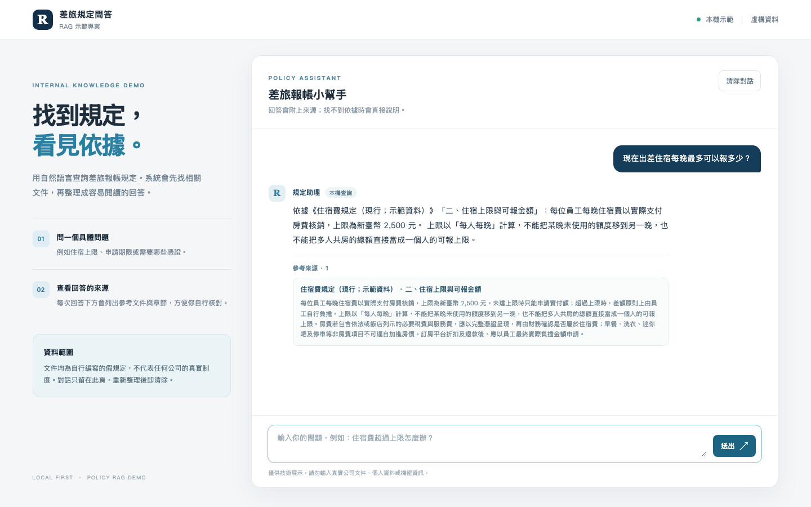
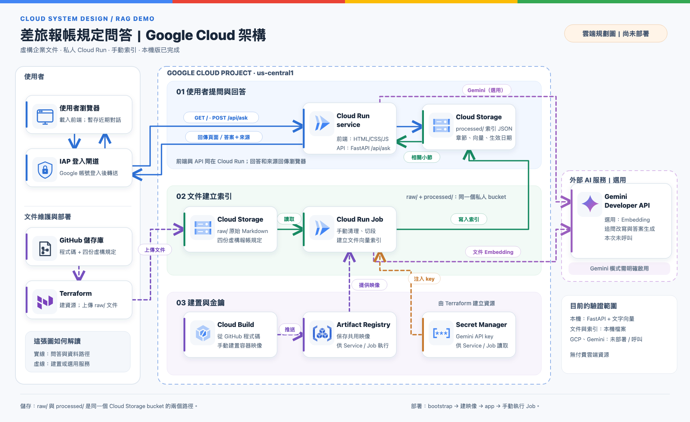
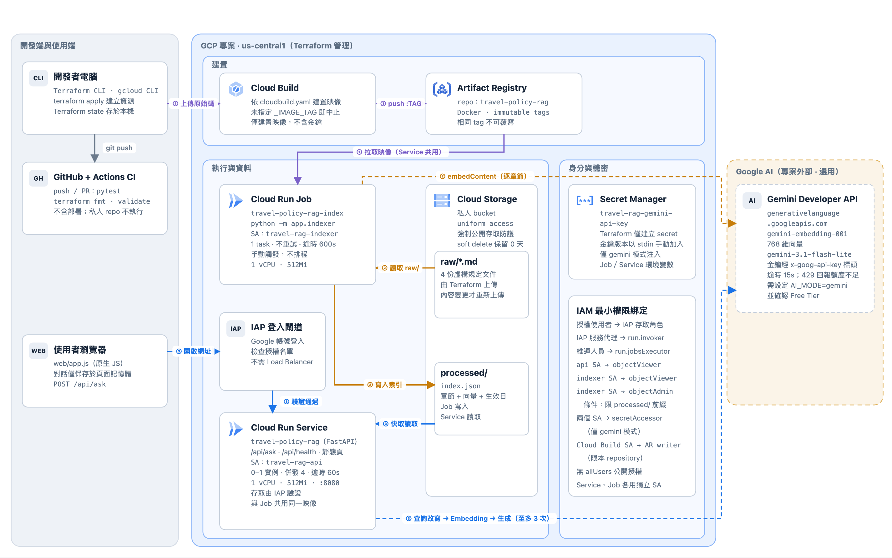

# 差旅報帳規定問答系統

這是**假想企業內部文件問答示範**。使用者在網頁輸入問題，系統從自編的差旅報帳規定找出相關小節，回答並列出文件來源。所有規定、金額、日期及流程都是虛構測試資料，**不代表任何公司的制度**。

本專案預設在本機**完全離線**運作：不需要 API key、不連接 GCP 或 Gemini，也不產生雲端帳單。Gemini 串接與 GCP Terraform 架構保留供程式碼審查；本次沒有執行雲端部署。

## 快速導覽

| 想看什麼 | 位置 |
| --- | --- |
| 在本機執行 | [五分鐘在本機啟動](#五分鐘在本機啟動) |
| 雲端架構圖 | [架構與技術選擇](#架構與技術選擇)、[架構說明](docs/ARCHITECTURE.md) |
| 部署步驟與權限設計 | [docs/DEPLOYMENT.md](docs/DEPLOYMENT.md) |
| 問答與檢索程式 | [`app/rag.py`](app/rag.py)、[`app/indexer.py`](app/indexer.py) |
| Terraform | [`infra/bootstrap`](infra/bootstrap)、[`infra/app`](infra/app) |
| 需求規格與驗證紀錄 | [docs/PROJECT_PLAN.md](docs/PROJECT_PLAN.md) |
| 多人協作 Git 流程 | [docs/GIT_WORKFLOW.md](docs/GIT_WORKFLOW.md) |

## 主要功能

- 讀取四份有正式規定篇幅的 Markdown 文件，包括基本規範、交通餐費、現行住宿與舊版住宿。
- 文件依章節切段並建立可搜尋的文字向量；搜尋只使用目前生效的規定。
- 支援同一頁面的追問、顯示引用來源與清除對話。重新整理頁面後不保留聊天紀錄。
- 本機離線模式可直接測試；Gemini 模式只在使用者**明確設定**後才可能呼叫外部 API。
- 提供 GCP 架構圖、Terraform 兩階段部署設定、CI 與多人 Git 協作流程說明。

## 五分鐘在本機啟動

需要 Python 3.9 以上。以下指令只安裝本機 Python 套件；不會建立雲端資源。

```bash
python3 -m venv .venv
source .venv/bin/activate
python -m pip install -r requirements-dev.txt
python -m app.indexer
uvicorn app.main:app --reload --host 127.0.0.1 --port 8000
```

開啟 <http://127.0.0.1:8000>，例如問「住宿費每晚可以報多少？」或「那需要附什麼憑證？」。`python -m app.indexer` 會事先建立本機索引；若沒有先執行，後端也會在第一次提問時建立索引。



離線模式只會從找到的文件小節整理答案與來源，**不是由大型語言模型自由生成**。這讓專案在沒有免費 API 額度時仍可完整測試文件處理、版本過濾、搜尋、API 和網頁流程。若要驗證 Gemini 回答品質，必須使用自己已確認為 Free Tier 的專案；本次未執行該遠端測試。

## 架構與技術選擇



[放大檢視 SVG](docs/diagrams/cloud-architecture.svg) · [可編輯的 diagrams.net 檔](docs/diagrams/cloud-architecture.drawio) · [架構說明](docs/ARCHITECTURE.md)

### 詳細架構圖

下圖列出 Terraform 設定的實際資源名稱、service account、IAM 權限與執行規格。①②③ 分別對應建置映像、建立索引、使用者提問三條流程；虛線只在 `AI_MODE=gemini` 時發生。圖中內容都是設定，尚未在 GCP 上實際部署。



互動版 [`docs/diagrams/cloud-architecture-detailed.html`](docs/diagrams/cloud-architecture-detailed.html) 含逐步流程導覽；GitHub 不會直接執行 HTML，請下載後以瀏覽器開啟。

| 類別 | 技術及用途 |
| --- | --- |
| 產品形式 | 單頁內部文件問答示範；本機可直接執行。 |
| 前端 | 原生 HTML、CSS、JavaScript；送出問題、顯示回答與來源，不需建置工具。 |
| 後端 | Python FastAPI 提供網頁與 `/api/ask`；Uvicorn 啟動 HTTP 服務。 |
| 文件與索引 | Markdown 保存虛構規定；本機索引檔保存章節與文字向量。GCP 規劃改由 Cloud Storage 的 `raw/`、`processed/` 保存。 |
| 搜尋與 AI | 本機模式用文字向量相似度找小節，零外部呼叫；選用 Gemini Developer API 做 Embedding、追問改寫及生成回答。 |
| 雲端執行 | Terraform 規劃 Cloud Run service（以 IAP 驗證 Google 帳號登入）、手動 Cloud Run Job、Cloud Build、Artifact Registry、Secret Manager。尚未部署。 |
| 測試 | pytest 驗證文件處理、版本過濾、索引快取與 API；httpx 用來在測試中呼叫 FastAPI。 |

使用同一個 Cloud Storage bucket 的兩個路徑，是因為這個示範只有少量文件與章節；不需要為了小型資料量另外維護資料庫或向量服務。雲端服務保持私人存取，API key 不寫入 GitHub 或 Terraform state。這些都是設計目標，雲端設定是否可成功套用尚未實測。

## 測試

```bash
python -m pytest
```

GitHub Actions 在 push 與 Pull Request 時執行上述測試，以及 Terraform 的 `fmt` 與 `validate` 靜態檢查；CI 不含任何部署步驟。

可以手動檢查：

1. 問「目前住宿費上限是多少？」應引用現行住宿規定，不引用舊版金額。
2. 接著問「要附什麼？」應能利用近期對話找到住宿憑證條款。
3. 問文件沒有記載的補助，應明確表示找不到依據。
4. 重新整理網頁，舊對話應消失。

## 雲端與費用邊界

本次**沒有執行** `terraform apply`、Cloud Build、Cloud Run 或 Gemini API 呼叫。GCP 的免費用量不是零帳單保證；付費帳戶超出免費額度可能收費。若未來要部署，應先讀 [部署文件](docs/DEPLOYMENT.md)，確認帳戶、API 費率、額度與權限，再由使用者自己決定是否執行。免費額度用盡時，本程式不會自動升級付費或嘗試重置帳號額度。

## 專案結構

```text
.
├── app/                  FastAPI 後端：文件解析、索引、檢索、選用 Gemini 串接
├── web/                  前端頁面（原生 HTML、CSS、JavaScript）
├── policy_docs/          四份虛構差旅報帳規定（Markdown）
├── tests/                pytest 自動測試
├── infra/
│   ├── bootstrap/        Terraform 第一階段：API、Storage、Artifact Registry、Secret
│   └── app/              Terraform 第二階段：Cloud Run Service／Job、IAP、IAM
├── docs/
│   ├── ARCHITECTURE.md   架構與服務選擇理由
│   ├── DEPLOYMENT.md     部署步驟、權限與費用界線
│   ├── GIT_WORKFLOW.md   假設多人協作的 Git 流程
│   ├── PROJECT_PLAN.md   需求規格與驗證紀錄
│   ├── diagrams/         架構圖（PNG、SVG、HTML、diagrams.net）與產生腳本
│   └── images/           本機執行畫面
├── .github/workflows/    CI：pytest 與 Terraform 靜態檢查
├── Dockerfile            Cloud Run 映像
└── cloudbuild.yaml       Cloud Build 建置設定（手動執行）
```

## 已知限制

- 本機離線回答是抽取式搜尋展示；Gemini 模式與 GCP 部署尚未實際驗證。
- 除 IAP 的登入名單外，沒有應用程式內的使用者帳號、細分文件權限、真實報銷進度查詢或持久化聊天紀錄。
- 虛構規定可用來測試系統流程，但不能代替任何公司的真實制度。

後續若擴充真實企業場景，應先補使用者授權、文件存取權限、資料地區與更新稽核，再考慮更多文件及專用向量儲存。
