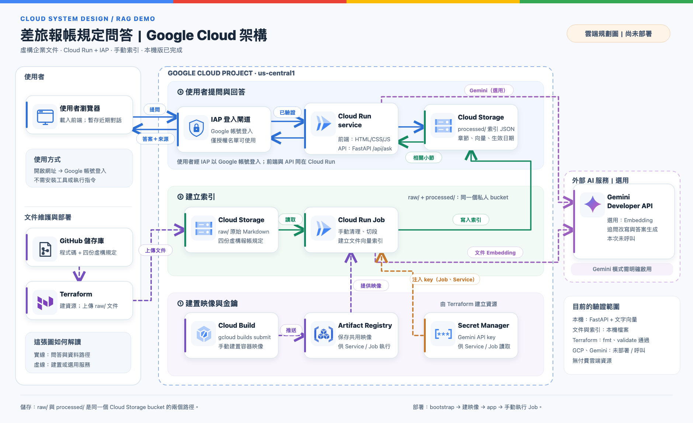

# 報帳規定 RAG：雲端架構說明（規劃版）

這是面試實作測驗的**目標雲端架構圖**，尚未部署。程式另有預設離線的本機模式：直接讀取專案內的文件與索引，不呼叫圖中的 GCP 或 Gemini。文件與規定均自行編寫，不包含真實企業資料。

可放大觀看：[SVG](diagrams/cloud-architecture.svg) · [互動 HTML](diagrams/cloud-architecture.html) · [diagrams.net 可編輯檔](diagrams/cloud-architecture.drawio)。另有[詳細版架構圖](diagrams/cloud-architecture-detailed.html)，列出資源名稱、IAM 權限、各流程步驟與架構改進點。`.drawio` 可在免費的 diagrams.net 匯入後調整方塊和箭頭；圖檔可直接放進 GitHub README 或繳交郵件。

## 用一句話說明

本機先把自編報帳規定切段並建立文字向量索引；使用者提問時，FastAPI 找到現行規定的相關小節，再抽取相關文字並附來源。圖中的雲端模式才會使用 Cloud Storage 和 Gemini 生成答案。

## 每個部分負責什麼

| 部分 | 白話用途 | 選用原因 |
| --- | --- | --- |
| GitHub | 保存 Python 程式、Terraform 和四份自編 Markdown 規定。 | 繳交時提供原始碼與可追蹤的修改紀錄。 |
| Terraform | 用程式寫出雲端資源設定，分 `bootstrap` 與 `app` 兩階段建立。 | 面試官可以檢查資源怎麼建立，也能用自己的專案重建。 |
| Cloud Storage | 同一個私人 bucket 下，`raw/` 放原始文件，`processed/` 放處理後小節與向量。 | 文件量小，用物件儲存即可；不必為示範系統維護另一個資料庫。 |
| Cloud Run Job | 修改文件後手動執行：清理、依章節切段、呼叫 Embedding，更新索引。 | 文件處理不必隨時運作，也不需要排程。 |
| Cloud Run service | 執行 FastAPI，提供前端頁面與 `/api/ask`；只允許經身分驗證存取。 | 一個 Python 服務就能承載網頁及問答 API，適合小型示範。 |
| IAP（Identity-Aware Proxy） | 使用者開啟 Cloud Run 網址後，以 Google 帳號登入；只有授權名單內的帳號能進入。 | 使用者不需安裝工具或執行指令；服務不公開，且直接啟用於 Cloud Run，不需要 Load Balancer。 |
| Gemini Developer API | **選配雲端模式**：將文件和問題轉成向量、補全追問、根據找到的小節整理答案。 | 展示 AI 串接設計；本次為避免任何帳單，沒有實際呼叫。 |
| Secret Manager | 保存 Gemini API key，讓 Service 和 Job 依權限讀取。 | 金鑰不放在 GitHub、瀏覽器或 Terraform state。 |
| Cloud Build、Artifact Registry | 前者建出程式映像，後者保存映像供 Service 和 Job 使用。 | 雲端執行時使用同一份程式版本。 |

## 三條主要流程

編號與架構圖的 ①②③ 一致。

1. **① 建置映像：** Terraform 先建儲存空間與映像庫。（選用）手動把 API key 加入 Secret Manager；以 `gcloud builds submit` 交由 Cloud Build 建置映像後，Terraform 再建 Service、Job、IAP 與權限。
2. **② 建立索引：** Terraform 把虛構規定上傳至 `raw/`；手動執行 Job，讀取文件、依 `##` 切小節、標記生效日期並建立向量（預設本機 TF-IDF，gemini 模式改用 Gemini Embedding），寫入 `processed/`。本機模式則直接讀 `policy_docs/`，完全不連線雲端。
3. **③ 使用者提問：** 使用者開啟 Cloud Run 網址、經 IAP 以 Google 帳號登入後呼叫私人 FastAPI。FastAPI 以近期對話輔助搜尋，只在現行規定中找出最相關的三個小節，再抽取文字（gemini 模式改由 Gemini 生成）並附來源。找不到支持內容時，明說沒有資料。

## 安全與範圍

- 前端不接觸 API key；GCP Service 和 Job 才能讀取 Secret Manager。
- 本機預設 `AI_MODE=local`，沒有 Gemini/GCP 網路呼叫；選用雲端模式需要明確切換設定，不會因免費額度用盡而自動轉成付費模式。
- Cloud Run 保持私人存取，由 IAP 驗證登入帳號；Cloud Storage bucket 也不公開。若部署到自己的專案，先確認帳戶、免費額度及資源設定符合零支出要求；架構圖本身不保證免費。
- 此示範除了 IAP 的登入名單外，沒有應用程式內的使用者帳號、細分文件權限、聊天紀錄資料庫、向量資料庫或自動更新排程。追問只依瀏覽器送來的近期對話處理。
- 日後若換成真實企業文件，需另外評估權限隔離、資料存放地區、文件更新流程與稽核；這些不屬於本次假資料示範。

## 編輯與重產生

主圖由 `diagrams/render_architecture.py` 定義版面並產生；同時輸出 `cloud-architecture.archify.json` 作為節點與連線的機器可讀摘要。執行 `python3 docs/diagrams/render_architecture.py` 可重產 SVG、HTML 與 `.drawio`。如果本機已有 Python Playwright 與 Chromium，還會產生 PNG；沒有時可直接使用 SVG。HTML 頁面可點選不同流程突出顯示對應連線。

Cloud Storage、Cloud Run、Cloud Build、Artifact Registry 與 Secret Manager 的彩色 SVG 來自 [Google Cloud 官方圖示庫](https://cloud.google.com/icons)的 legacy set，檔案保存在 `docs/diagrams/icons/`；瀏覽器、GitHub、Terraform、proxy 與 Gemini 使用本專案繪製的輔助圖示。`.drawio` 中的方塊、箭頭與圖示都可在免費的 diagrams.net 編輯。
