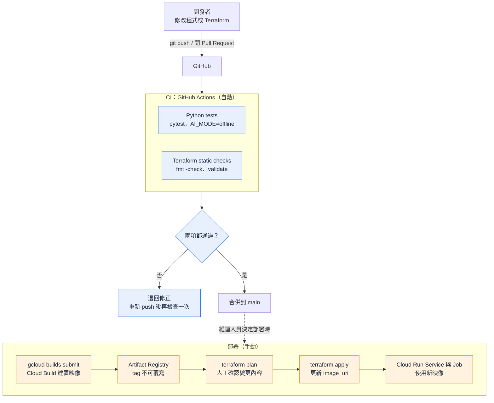
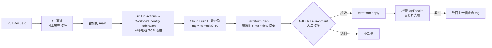

# CI/CD 流程

本文件說明程式從修改到上線的流程。**CI（持續整合）已實際運作**：每次 push 與 Pull Request 都會自動檢查。**CD（持續部署）刻意保持手動**，本專案也沒有實際部署；第 4 節是日後自動化部署的設計。

## 1. 目前的流程

| 階段 | 方式 | 內容 |
| --- | --- | --- |
| 觸發 | 自動 | 任何分支 push，或開 Pull Request。 |
| Python tests | 自動 | 安裝依賴後執行 `pytest`，固定 `AI_MODE=offline`，不連接任何雲端服務。 |
| Terraform static checks | 自動 | `terraform fmt -check` 檢查格式；`bootstrap` 與 `app` 兩階段各自 `init -backend=false` 後 `validate`，不讀取 GCP 帳戶。 |
| 建置映像 | 手動 | `gcloud builds submit` 交由 Cloud Build 建置；未指定 `_IMAGE_TAG` 時直接中止。 |
| 保存映像 | 自動（由 Cloud Build 推送） | Artifact Registry 開啟 immutable tags，同一個 tag 不能被覆寫。 |
| 部署 | 手動 | 把新映像填入 `image_uri`，先 `terraform plan` 確認變更，再 `terraform apply`。Cloud Run Service 與 Job 都改用新映像。 |

設定檔：[`.github/workflows/ci.yml`](../.github/workflows/ci.yml)、[`cloudbuild.yaml`](../cloudbuild.yaml)。

## 2. CI 的安全設計

- **最小權限**：workflow 只有 `contents: read`，不能修改 repo。
- **沒有雲端憑證**：CI 不保存任何 GCP 金鑰，也不執行 `plan` 或 `apply`，因此不可能誤部署或產生雲端費用。
- **與雲端無關的測試**：測試以離線模式執行，Vertex AI 的呼叫以假連線驗證請求格式，不實際連網。
- **私人 repo 不執行**：私人 repo 使用 GitHub Actions 可能產生費用，因此兩個 job 只在公開 repo 執行。

## 3. 為什麼部署保持手動

| 考量 | 說明 |
| --- | --- |
| 權限風險 | 自動部署需要讓 GitHub 取得 GCP 的部署權限，必須先設計安全的驗證方式（見第 4 節）。 |
| 變更可控 | Terraform 會修改權限、Eventarc 與監控設定，上線前應由人看過 `plan` 的內容。 |
| 費用 | 本專案只做設計，不建立雲端資源。 |

**回復方式**：映像 tag 不可覆寫，每個版本都保留在 Artifact Registry。新版本有問題時，把 `image_uri` 改回上一個 tag 再 `terraform apply`，Cloud Run 會用舊映像建立新的 revision。

## 4. 日後的自動部署設計（未實作）

| 設計 | 目的 |
| --- | --- |
| Workload Identity Federation | GitHub Actions 以短期憑證登入 GCP，不在 GitHub 保存長期金鑰。 |
| 映像 tag 使用 commit SHA | 每個部署版本都能對應到確切的程式碼。 |
| GitHub Environment 核准 | `apply` 前必須由指定人員核准，保留人工把關。 |
| 部署後檢查 | 確認 `/api/health` 正常、Cloud Monitoring 沒有告警；異常時改回上一個 tag。 |
| 專用部署服務帳號 | 只授予部署需要的權限，與執行期的服務帳號分開。 |
| Terraform state 放 GCS | 自動部署與多人操作需要共享、可鎖定的 state。 |
