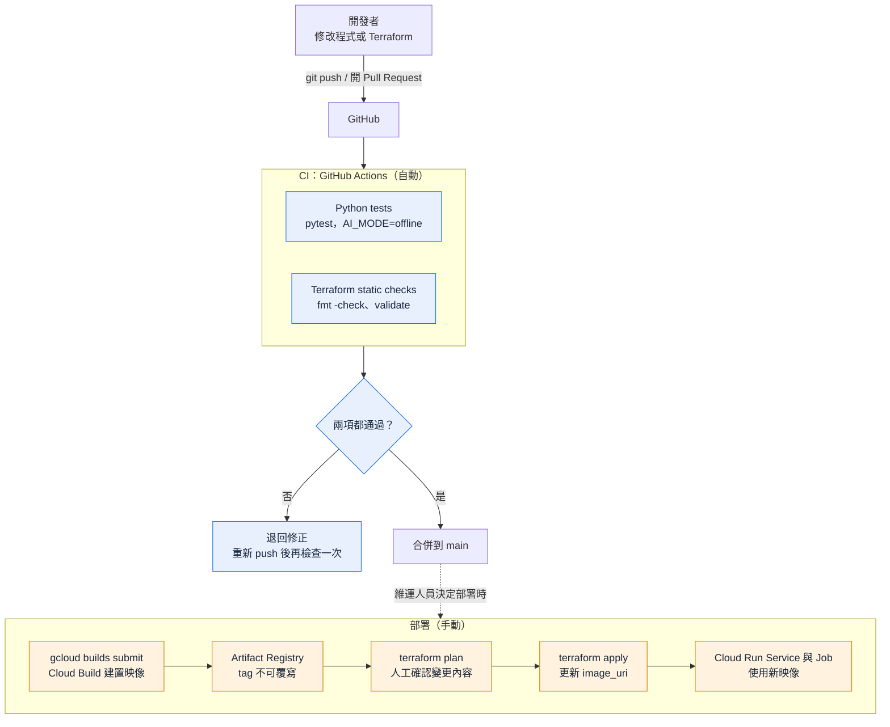

# CI/CD 流程

本文件說明程式從修改到上線的流程。**CI（持續整合）已實際運作**：每次 push 與 Pull Request 都會自動檢查。**部署刻意保持手動**，本專案也沒有實際部署。

## 1. 目前的流程

| 階段 | 方式 | 內容 |
| --- | --- | --- |
| 觸發 | 自動 | 任何分支 push，或開 Pull Request。 |
| Python tests | 自動 | 執行 `pytest`，使用離線模式，不連接任何雲端服務。 |
| Terraform static checks | 自動 | 檢查 Terraform 的格式（`fmt`）與語法（`validate`），不連接 GCP。 |
| 建置映像 | 手動 | `gcloud builds submit` 交由 Cloud Build 把程式打包成映像。 |
| 保存映像 | 自動（由 Cloud Build 推送） | 存進 Artifact Registry，同一個 tag 不能被覆寫。 |
| 部署 | 手動 | 先 `terraform plan` 確認會改什麼，再 `terraform apply`，Cloud Run 改用新映像。 |

設定檔：[`.github/workflows/ci.yml`](../.github/workflows/ci.yml)、[`cloudbuild.yaml`](../cloudbuild.yaml)。

## 2. CI 的安全設計

- CI 只能讀取程式碼，不能修改 repo。
- CI 裡沒有任何 GCP 金鑰，所以不可能誤部署，也不會產生雲端費用。

## 3. 為什麼部署保持手動

- 自動部署需要把 GCP 權限交給 GitHub，要先設計安全的做法；這次沒有實作，列為日後改進。
- Terraform 會修改權限、自動觸發與監控設定，上線前應由人看過 `plan` 的結果。

**出問題時**：每個版本的映像都保留在 Artifact Registry，而且不能被覆寫。把 `image_uri` 改回上一個版本的 tag，再 `terraform apply` 一次即可。
