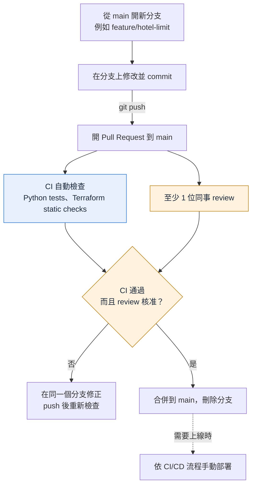

# 多人協作 Git 流程

本專案目前由一人開發。本文件說明**如果交給團隊維護**，應該怎麼分工與合併。下面的分支保護規則是建議設定，目前的 repo 沒有開啟。

## 1. 流程

重點只有一個：**沒有人直接改 `main`**。所有修改都先放在自己的分支，經過 CI 與同事確認後才合併。部署步驟見 [CI/CD 流程](CICD.md)。

## 2. 這個專案的三條規則

| 規則 | 內容 | 原因 |
| --- | --- | --- |
| 保護 `main` | 在 GitHub 設定分支保護：禁止直接 push，合併前必須通過 `Python tests` 與 `Terraform static checks`，並有 1 位 reviewer 核准。 | 確保 `main` 隨時都是測試通過、可以部署的版本。 |
| Terraform 修改要附 `plan` | 修改 `infra/` 的 Pull Request，要附上 `terraform plan` 的結果。 | Terraform 會改權限、自動觸發與監控。CI 只檢查語法，看不出會改到什麼，reviewer 要看 `plan` 才能判斷。 |
| 差旅規定不走 Git | 規定文件由管理者直接上傳到 Cloud Storage 的 `raw/`，系統會自動重建索引。 | 規定更新是業務資料，不是程式修改。管理者不需要會用 Git，也不用等工程師合併。 |

## 3. 分支命名

| 前綴 | 用途 | 例子 |
| --- | --- | --- |
| `feature/` | 新功能 | `feature/hotel-limit` |
| `fix/` | 修正錯誤 | `fix/empty-answer` |
| `infra/` | 修改 Terraform | `infra/alert-threshold` |
