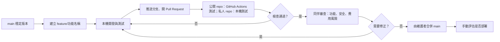

# 假設多人協作的 Git 流程

這是面試測驗的**設計示例**，不宣稱這份作品真的由多人協作。每位開發者先從 `main` 建自己的功能分支；功能、文件與 Terraform 都經 Pull Request 審查後才合併。

建議把一個 PR 控制在一個目的，例如「補上過期規定過濾」或「調整 Terraform 權限」。審查者檢查測試是否涵蓋修改、API key 是否只在本機/Secret Manager、Terraform 是否引入新計費資源。公開儲存庫使用免費標準 runner；私人儲存庫為避免超額計費，workflow 會跳過 job，審查者應要求本機測試結果。CI 不會替任何人部署；若未通過費用評估，合併後仍只維持本機可執行版本。
